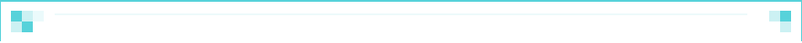
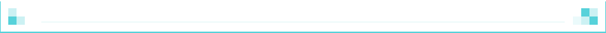
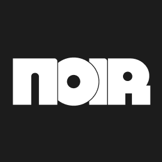
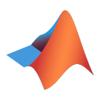
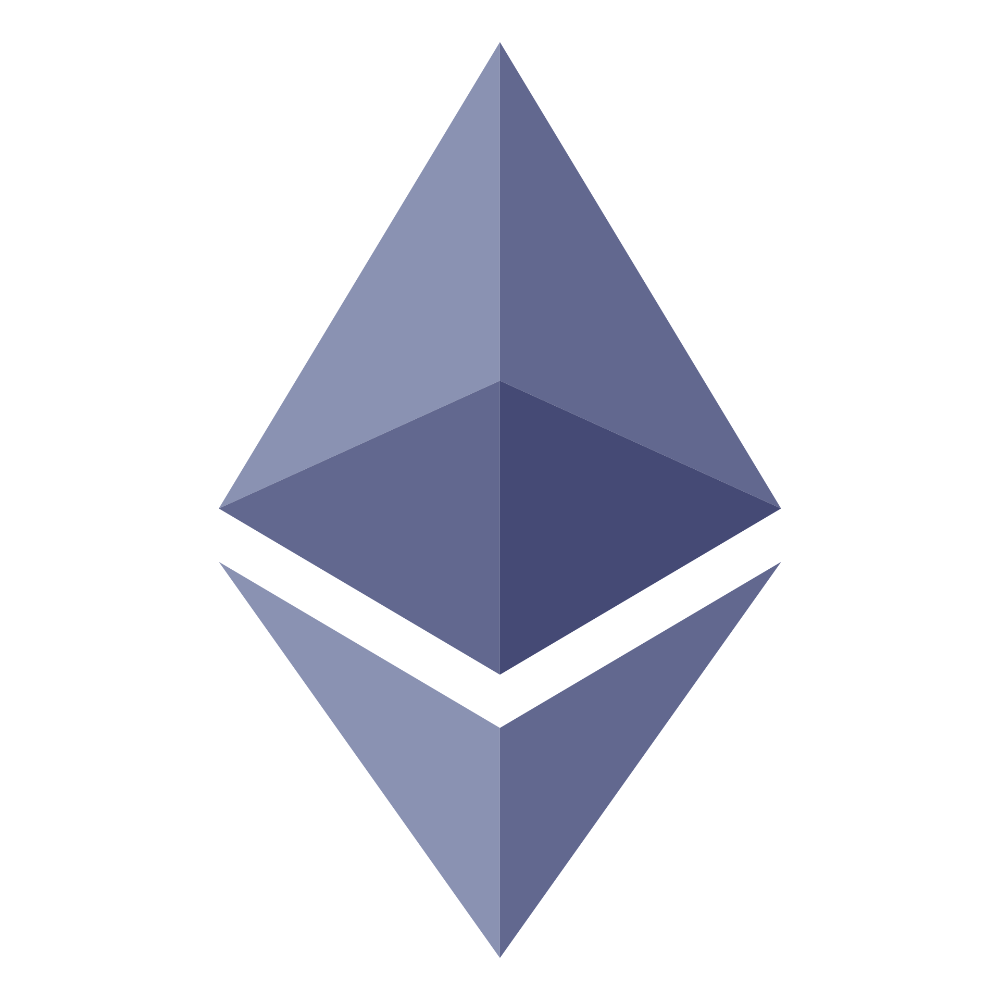
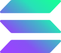

<table>
<tr><td width="880" align="center">

<samp>PHTPSN</samp>

<h1>Build small. Think deeply.</h1>

Exploring privacy, useful AI, and verifiable systems.

</td></tr>
</table>

<h3>Working with</h3>

 &ensp;
<a href="https://www.rust-lang.org/" title="Rust"><picture><source media="(prefers-color-scheme: dark)" srcset="assets/icons/rust-dark.svg"></picture></a> &ensp;
 &ensp;
 &ensp;
<a href="https://soliditylang.org/" title="Solidity"><picture><source media="(prefers-color-scheme: dark)" srcset="assets/icons/solidity-dark.svg"></picture></a> &ensp;
 &ensp;
 &ensp;
 &ensp;
 &ensp;
 &ensp;
 &ensp;
 &ensp;

<h3>Selected projects</h3>

<strong><a href="https://github.com/mon-PHTPSN/Permio">Permio</a></strong> 
Context-bound permissions and programmable privacy, built around Midnight and Monad.

<strong><a href="https://github.com/PHTPSN/PACT">Pact</a></strong> 
An AI treasury agent that spends within team-approved budgets while people retain shared control.

<strong><a href="https://github.com/PHTPSN/Unjot">Unjot</a></strong> 
Learn languages without taking notes. A local web app built around conversation and learning evidence.

<strong><a href="https://github.com/PHTPSN/leanp2p">leanp2p</a></strong> 
Building libp2p in Lean 4, starting with Ethereum consensus networking. An Invisible Garden project.

